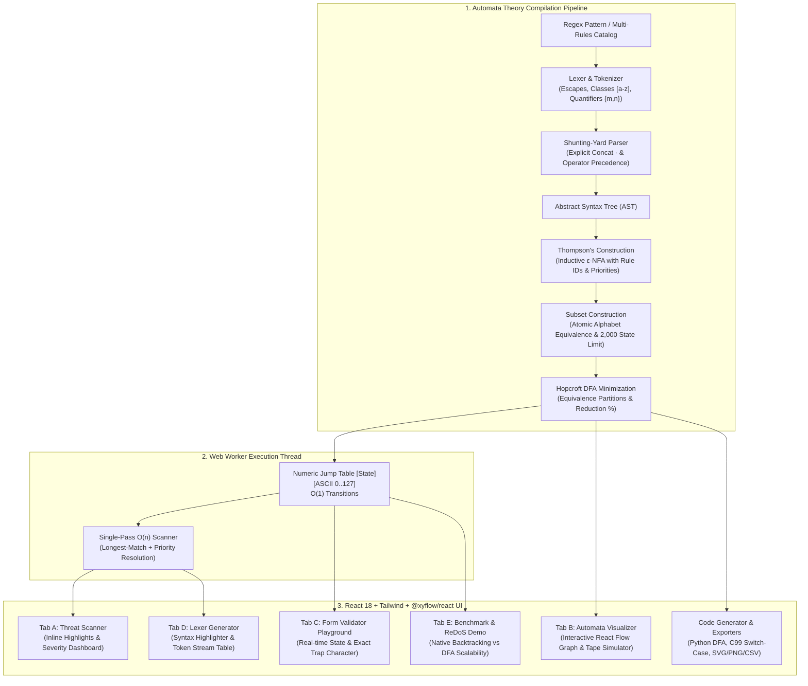

# PatternGuard — DFA-Powered Log & Input Scanner

> A high-performance, deterministic automata theory engine in TypeScript and React that applies formal language theory (**Regex → Shunting-Yard AST → Thompson ε-NFA → Subset Construction DFA → Hopcroft Min-DFA**) to scan logs, tokenize code, validate input grammars, and defend against **Regular Expression Denial of Service (ReDoS)** in strictly $O(n)$ single-pass time.

---

## 1. Problem Statement: The ReDoS Vulnerability

Traditional regular expression engines (including the PCRE implementations in Node.js/V8, Python `re`, Java, and Ruby) rely on **Non-Deterministic Finite Automata with Recursive Backtracking**.

When given nested quantifiers or overlapping alternations such as:
$$\text{Evil Pattern: } (a+)+b \quad \text{or} \quad (a|a+)+\$$
against adversarial inputs like $a^n c$:
- The backtracking engine explores all possible permutations of matching the prefixes.
- For an input of length $n$, the search space degrades exponentially to **$O(2^n)$**.
- An input as short as 28 characters can lock a CPU thread for **tens of seconds**, while 32 characters causes complete server freeze and Denial of Service.

### The Solution: Deterministic Finite Automata (DFA)
PatternGuard converts regular expressions into **Canonical Minimal DFAs**. In a DFA:
- Each state has at most **one** deterministic transition per input symbol.
- Every character in an input stream of length $n$ is processed in **strictly 1 step ($O(1)$)**.
- Total scanning time is strictly **$O(n)$** with **zero backtracking**, regardless of payload complexity.

---

## 2. System Architecture



---

## 3. Formal Algorithms & Computational Complexity

| Algorithm | Theoretical Complexity | Role in PatternGuard |
| :--- | :--- | :--- |
| **Shunting-Yard Parser** | $\mathcal{O}(m)$ time, $\mathcal{O}(m)$ space | Converts infix regex to postfix notation and constructs the AST hierarchy with operator precedence (`(*,+,?,{m,n}) > · > \|`). |
| **Thompson's Construction** | $\mathcal{O}(m)$ time, at most $2m$ states | Inductively builds an $\epsilon$-NFA with atomic character matchers. Unifies multiple rules under a root start state. |
| **Subset Construction** | $\mathcal{O}(2^{\|Q\|})$ worst-case, $\mathcal{O}(\|\Sigma\| \cdot \|Q_D\|)$ average | Converts non-deterministic $\epsilon$-closures into deterministic DFA states. Partitions ASCII into atomic equivalence classes. Enforces a **2,000-state safety threshold**. |
| **Hopcroft's Minimization** | $\mathcal{O}(\|\Sigma\| \cdot \|Q\| \log \|Q\|)$ | Refines distinguishable equivalence partitions until a fixed point is reached, yielding the unique canonical minimal DFA and reduction %. |
| **Jump-Table Scanner** | $\mathcal{O}(n)$ time, $\mathcal{O}(1)$ space per char | Processes input text across all compiled rules simultaneously with zero backtracking. Guarantees ReDoS immunity. |

---

## 4. Key Features by Module

### Tab A: Threat Scanner (Main)
- Scans multi-megabyte log files in a single pass.
- Color-coded severity highlights (**CRITICAL**, **HIGH**, **MEDIUM**, **LOW**, **INFO**).
- 10 Built-in security & PII signatures:
  1. *SQL Injection* (`' OR 1=1`, `UNION SELECT`, `--`)
  2. *Cross-Site Scripting (XSS)* (`<script`, `onerror=`, `onload=`)
  3. *Path Traversal* (`../`, `..\`)
  4. *Failed Authentication* (`Failed password`, `failed login`)
  5. *IPv4 Addresses* (`\d{1,3}\.\d{1,3}\.\d{1,3}\.\d{1,3}`)
  6. *Email Addresses* (`[a-zA-Z0-9._%+-]+@[a-zA-Z0-9.-]+\.[a-zA-Z]{2,}`)
  7. *Indian Phone Numbers* (`(\+91[\s-]?)?[6-9]\d{9}`)
  8. *PAN Cards* (`[A-Z]{5}\d{4}[A-Z]`)
  9. *16-Digit Payment Cards* (`\d{4}[-\s]?\d{4}[-\s]?\d{4}[-\s]?\d{4}`)
  10. *API Key / Token Leaks* (`AKIA...`, `ghp_...`, `eyJ...`)
- Live rule management with dynamic syntax compilation and `localStorage` persistence.
- Export scan reports as **CSV** or **JSON**.

### Tab B: Automata Visualizer
- Visualizes $\epsilon$-NFA, Subset DFA, and Min-DFA using `@xyflow/react`.
- Features: green start arrow, double-ring accept states, trap state toggle ($\emptyset$), merged parallel edges, self-loops.
- Step-by-step interactive tape simulator with Spacebar (Play/Pause) and Arrow keys (Step).
- Exports:
  - Graph as **SVG** or **PNG** (2x high-resolution canvas).
  - Automaton as structured **JSON**.
  - Min-DFA code generation for **Python** and **C99 switch-case**.

### Tab C: Form Validator Playground
- Real-time DFA evaluation for Email, Username, Phone, and URL.
- Live display of the active DFA state (`M0`, `M1`, ..., `q_dead`).
- Pinpoints the **exact character** and position where invalid input transitions into the dead Trap State.
- Conjunction password validator evaluating 4 independent component DFAs simultaneously (Length 8+, Digit, Uppercase, Lowercase).

### Tab D: Lexer Generator
- Define custom token grammars: `KEYWORD`, `IDENTIFIER`, `NUMBER`, `OPERATOR`, `STRING`, `PUNCTUATION`.
- Compiles rules into a unified minimal DFA with priority conflict resolution.
- Live syntax highlighting of code snippets and a structured token table.

### Tab E: Benchmark & ReDoS Demo
- Tests the catastrophic backtracking pattern `(a+)+$` against adversarial strings $a^n b$.
- Compares native JavaScript `RegExp` (with a 1,000ms timeout guard) against PatternGuard's DFA engine.
- Visual latency scalability chart and bulk throughput benchmark measuring **Characters / Second** and **MB/s**.

---

## 5. Local Setup & Verification

### Prerequisites
- Node.js v18+ (tested on Node v22.23.2)
- npm v9+

### Installation & Execution
```bash
# 1. Install dependencies
npm install

# 2. Run unit test suite (24 tests)
npm test

# 3. Compile TypeScript & bundle production assets
npm run build

# 4. Start local development server
npm run dev
```

---

## 6. Resume Bullet Points (Senior Full-Stack / Systems Engineer)

- **Engineered PatternGuard**, a high-throughput DFA log scanner and automata compiler in TypeScript and React 18, applying formal language theory (AST → Thompson $\epsilon$-NFA → Subset Construction → Hopcroft Minimization) to guarantee strictly $O(n)$ scanning and total immunity to ReDoS.
- **Implemented multi-pattern union construction** with priority-based longest-match resolution, compiling multiple threat signatures (SQLi, XSS, API keys, PII) into a single minimized DFA operating via a numerical jump table for sub-millisecond execution.
- **Designed a multithreaded architecture** utilizing Web Workers with custom structured-clone serialization (eliminating function closures and non-cloneable objects) to offload intensive DFA compilation and multi-megabyte scanning from the main UI thread.
- **Built an interactive automata visualizer** with `@xyflow/react` and Tailwind CSS, rendering topological DAG graph layouts, self-loops, double-ring accept states, and an interactive tape head simulator with keyboard navigation.
- **Authored a comprehensive test suite in Vitest** (24 tests) covering edge cases including empty strings ($\epsilon$), nested Kleene stars, canonical $(a|b)^*abb$ minimization, ReDoS adversarial inputs, and structured-clone fidelity.
